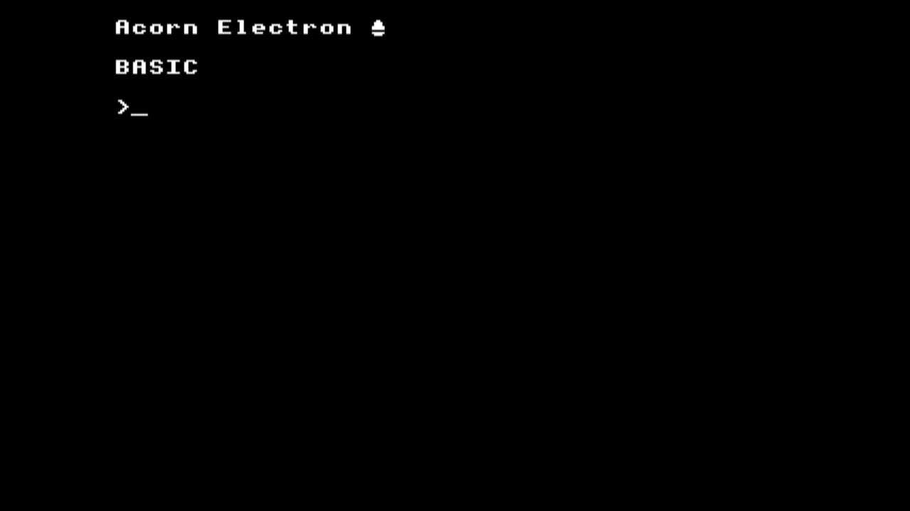
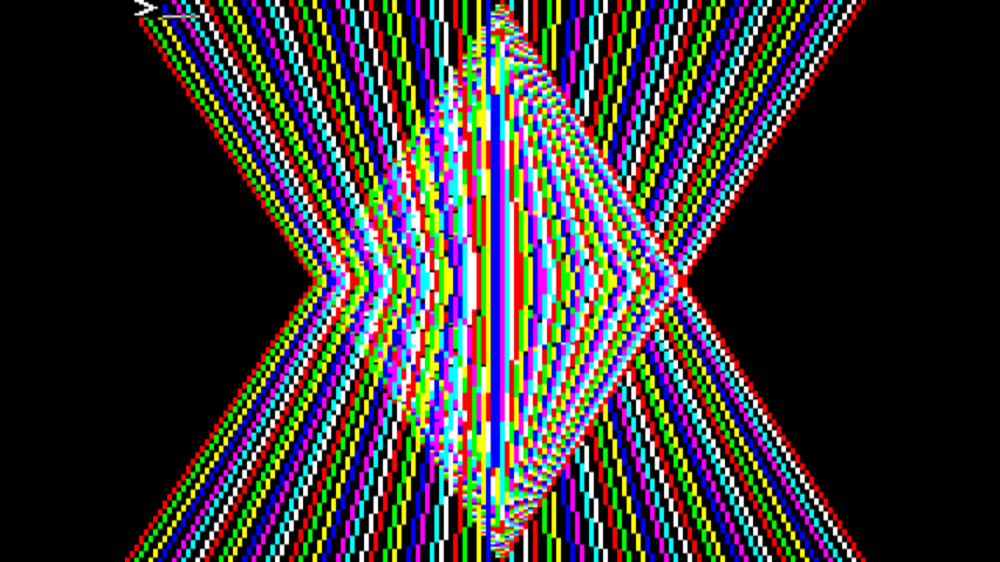
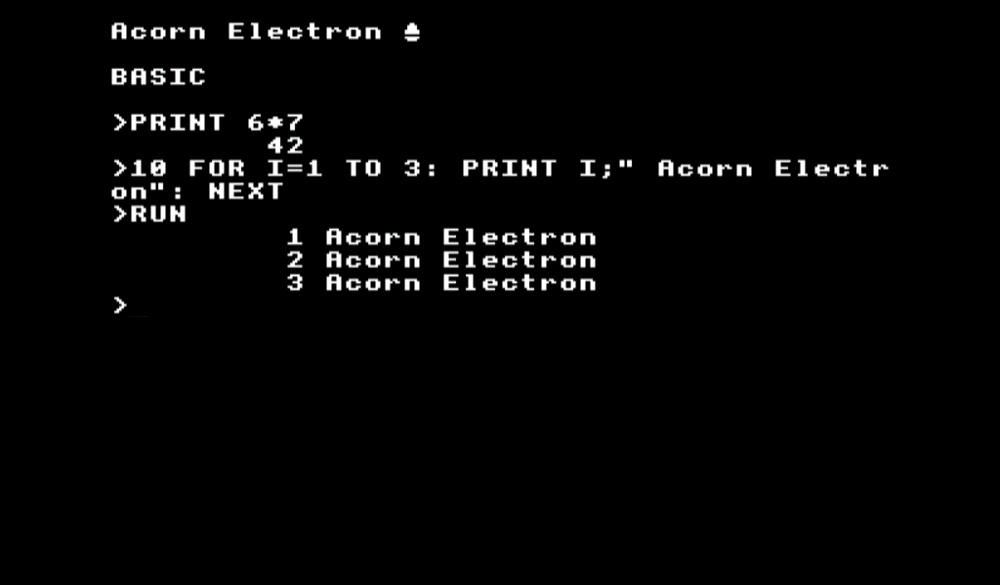
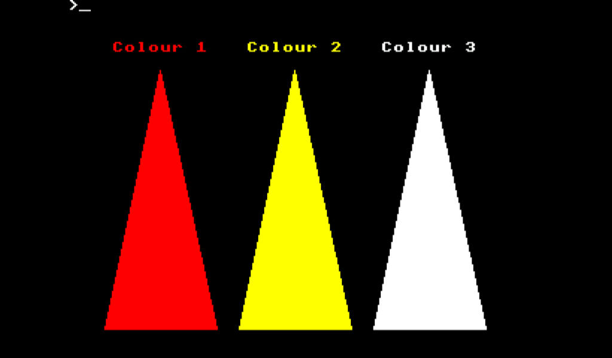

<h1 align="center">esp32electron</h1>

<p align="center">
  <b>An Acorn Electron on a 7-inch ESP32-S3 touch-screen board or an M5Stack Tab5.</b><br>
  A 6502 with the ULA's 2 MHz ROM and 1 MHz RAM timing and its screen contention,<br>
  display modes 0-6, BBC BASIC II and the Electron's MOS.
</p>

<p align="center">
  
  
  
  
  
  
</p>

<p align="center">
  <b>Early development:</b> the MOS, BBC BASIC, the display, sound and the keyboard work on both
  boards; cassette tapes (UEF) and the Plus 3's floppy disks come next.
</p>

<p align="center">
  
  
  <br>
  
  
  <br>
  <sub>The power-on screen and a fan of lines in mode 2 on the Tab5; BASIC typed in and mode 1's
  colours on the MaTouch. Screenshots from the boards.</sub>
</p>

esp32electron turns the Makerfabs MaTouch ESP32-S3 Parallel TFT with Touch 7",
or an M5Stack Tab5, into an Acorn Electron. A setup screen on the touch panel,
and a web page on your network, handle the machine and its files on the
microSD card.

It's the sibling of [esp32ste](https://github.com/rlucencic/esp32ste) (Atari
STE), [esp32mac](https://github.com/rlucencic/esp32mac) (Macintosh Plus, SE,
Classic), [esp32mac2](https://github.com/rlucencic/esp32mac2) (Macintosh LC
and II, Tab5 only), [esp32mac3](https://github.com/rlucencic/esp32mac3)
(Macintosh LC II and LC III, Tab5 only),
[esp32cpc](https://github.com/rlucencic/esp32cpc) (Amstrad CPC),
[esp32zx](https://github.com/rlucencic/esp32zx) (ZX Spectrum 128K, +2, +3),
[esp32cbm](https://github.com/rlucencic/esp32cbm) (Commodore 64 and 128),
[esp32xl](https://github.com/rlucencic/esp32xl) (Atari 800XL and 130XE),
[esp32msx](https://github.com/rlucencic/esp32msx) (MSX1 and MSX2),
[esp32gs](https://github.com/rlucencic/esp32gs) (Apple IIGS),
[esp32coco](https://github.com/rlucencic/esp32coco) (Tandy Color Computer 2
and 3), [esp32arc](https://github.com/rlucencic/esp32arc) (Acorn Archimedes,
Tab5 only), [esp32pc](https://github.com/rlucencic/esp32pc) (IBM PC/XT and
PC/AT), [esp32ql](https://github.com/rlucencic/esp32ql) (Sinclair QL) and
[esp32ami](https://github.com/rlucencic/esp32ami) (Amiga 500, 2000, 600 and
1200, Tab5 only); all are built on the shared runtime
[esp32emu](https://github.com/rlucencic/esp32emu), which also holds the 6502
core this one shares with the Commodores and the Atari.

## Status

**Working**
- The 6502A as the ULA runs it: ROM at 2 MHz, RAM at 1 MHz (an access waits
  for the 1 MHz clock), and in modes 0-3 no RAM access while the ULA reads
  a line of the screen. A BASIC loop (`FOR A=0 TO 10000:NEXT`) takes as
  long as on two real Electrons measured on the stardot forum:

  | Mode | 0 | 1 | 2 | 3 | 4 | 5 | 6 |
  |---|---|---|---|---|---|---|---|
  | esp32electron | 14.71 | 14.74 | 14.89 | 11.94 | 7.07 | 7.08 | 7.07 |
  | Electron (two machines) | 14.71 | 14.74 | 14.89-14.90 | 11.92-11.94 | 7.07-7.08 | 7.08 | 7.07-7.08 |

- The ULA: its interrupts (display end, the 50 Hz clock, at their measured
  places in the line), ROM paging, the screen start and hardware scrolling,
  interlaced fields of 312 and 313 lines.
- The display: modes 0-6 (640 x 256 in two colours down to 160 x 256 in
  sixteen; modes 3 and 6 with their blank lines between text rows), the
  palette, the MOS's flashing colours.
- Sound: the ULA's square wave, at the MOS's pitches.
- The keyboard: Bluetooth and USB keyboards (the Tab5 Keyboard too) by
  position; FUNC on Tab and Alt, the function keys f0-f9 on F1-F10, CAPS LK
  on Caps Lock, COPY on End, BREAK on Pause or F12.
- MOS 1.00 and BBC BASIC II at full speed on both boards (the MaTouch's
  emulation core 44% busy at the prompt, the Tab5's 23%).

**Next**, in order: cassette tapes (UEF images: the TOSEC collection's
games), the Acorn Plus 3 (ADFS floppy disks), original software and ROM
cartridges.

## Hardware

- **Makerfabs MaTouch ESP32-S3 Parallel TFT with Touch 7"** (ESP32-S3,
  16 MB flash, 8 MB PSRAM, 1024 × 600), or
- **M5Stack Tab5** (ESP32-P4, 1280 × 720).
- A microSD card (FAT32 or exFAT), a Bluetooth keyboard (the Tab5: USB too).

## Getting started

You need ESP-IDF 5.5 and [esp32emu](https://github.com/rlucencic/esp32emu)
cloned next to this repository.

1. Put the ROM images into `roms/` (`os_basic.ic2`, BASIC and the MOS, and
   `adfs.rom` for the Plus 3: see [roms/README.md](roms/README.md)).
2. Build and flash (`flash` also writes the ROMs into their partition):
   ```sh
   # MaTouch
   idf.py build && idf.py -p PORT flash
   # Tab5
   idf.py -B build-tab5 -DIDF_TARGET=esp32p4 -DSDKCONFIG=$PWD/build-tab5/sdkconfig build
   idf.py -B build-tab5 -DIDF_TARGET=esp32p4 -DSDKCONFIG=$PWD/build-tab5/sdkconfig -p PORT flash
   ```
3. Tap Start on the setup screen; the web page is at
   `http://acorn-electron.local`.
4. Type BASIC on a Bluetooth or USB keyboard. The keys are where a US
   keyboard has them; `=` is the Electron's ← key and `[` `]` its ↑ ↓, as
   on the Electron's own keyboard.

## Development

The machine (`components/electron`) is platform independent;
`components/electron/host` builds it for a PC, far faster than real time:

```sh
make -C components/electron/host run      # 300 frames: the BASIC prompt in build/screen.ppm
ELK_TYPE='40:PRINT 2+2\n' ./components/electron/host/build/elk_host roms/os_basic.ic2 200 out.ppm
```

`host_main.c` lists its other switches (traces, stops at a PC, watched
writes, keys, memory dumps, disassembly). `docs/electron-hardware.md` holds
the hardware research everything here is written from, with its sources.

## Credits

- The 6502 core is esp32emu's own.
- The ROMs: Acorn's MOS 1.00 and BBC BASIC II (Sophie Wilson and others).
  Not part of this repository: see roms/README.md.
- The Electron's hardware as the Acorn Electron Advanced User Guide (fifth
  edition, corrected against real machines by the stardot community)
  describes it; hoglet's scope measurements on stardot for the timing; the
  keyboard's layout as MAME's `electron.cpp` (BSD-3-Clause) has it.

## Licence

MIT, see [LICENSE](LICENSE). The ROMs are not covered by it.
